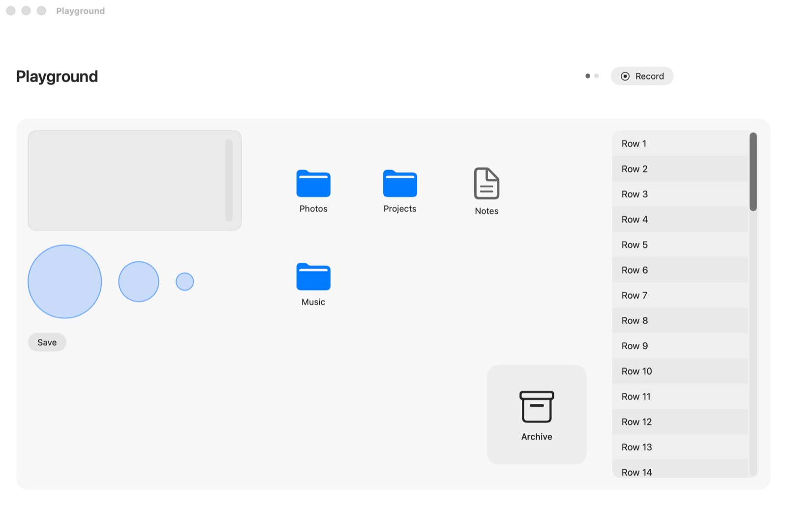

# Glide

Glide lets you control your Mac with your hand and your voice. It uses the built-in camera to read your hand. Your hand moves the pointer, and a pinch clicks. When you speak into a text field, Glide types the words for you.

Glide does the same jobs as a mouse or a trackpad. It does not add new controls. All hand tracking and speech recognition stay on your Mac.

I built Glide as a side project. It works, but it is an experiment. Expect rough edges.



## Gestures

| Gesture | Mouse or trackpad action |
|---|---|
| Move an open hand | Move the pointer |
| Pinch thumb and index finger, then open | Click |
| Pinch and hold until the ring fills | Right-click |
| Pinch thumb and middle finger, then open | Right-click |
| Pinch, then move | Drag |
| Close your hand, then move it | Scroll |
| Spread your hand, then swipe left or right | Go to the next or previous desktop |
| Hold up two fingers in a text field, then speak | Type with your voice |
| Hold the fn key, then speak | Type with your voice |
| Hold a spread hand still for 1.5 seconds | Pause or resume Glide |

A ring at the pointer shows what Glide sees. The ring gets smaller as your fingers close. It fills while you hold a pinch. An arc at the pointer shows when your hand gets near the edge of the camera view.

## Requirements

- macOS 26 or later. The speech recognition uses the `SpeechAnalyzer` API from macOS 26.
- A Mac with a camera.
- The Xcode command line tools. The full Xcode app is not necessary.
- Apple Intelligence, if you want the text clean-up after dictation. Glide works without it.

## Build and run

1. Get the code:

   ```bash
   git clone https://github.com/euphoriawolf/glide.git
   cd glide
   ```

2. Make a local signing identity. Do this one time:

   ```bash
   ./scripts/setup-signing.sh
   ```

   The script makes a self-signed certificate in its own keychain file in `.signing/`. Your login keychain does not change. macOS gives permissions to a signed app, so a stable signature keeps your permissions when you build again.

3. Build the app:

   ```bash
   ./scripts/build-app.sh
   ```

4. Open the app:

   ```bash
   open build/Glide.app
   ```

5. Follow the setup window. Glide asks for these permissions:
   - **Camera**, to see your hand.
   - **Accessibility**, to move the pointer and to send clicks.
   - **Microphone** and **Speech Recognition**, for dictation.

6. To switch desktops with a swipe, turn on the shortcuts for **Move left a space** and **Move right a space**. They are in System Settings › Keyboard › Keyboard Shortcuts › Mission Control.

Press ⌃⌥Space to turn Glide on or off. Press ⌃⌥P to show or hide the camera preview.

## How it works

The code is a Swift package with five targets:

| Target | What it does |
|---|---|
| `GlideVision` | Reads the camera frames with Apple Vision (`VNDetectHumanHandPoseRequest`). It finds the joints of one hand. It makes the image brighter in low light. |
| `GlideCore` | Turns the hand joints into mouse actions. It holds the gesture rules, the pointer acceleration and a One Euro filter that removes jitter. It has no dependency on the camera, so the checks and the replay tool can use it. |
| `Glide` | The menu bar app. It sends the mouse and keyboard events, shows the ring at the pointer, and runs the setup window, the settings, dictation and the playground. |
| `GlideChecks` | Checks for the gesture rules with recorded hand shapes. Run `swift run GlideChecks`. |
| `GlideReplay` | Runs a recorded session through the same code as the app, frame by frame, and gives a score for each task. |

### Tune the rules with your own hand

Each threshold in the gesture rules comes from video of a real hand, not from a guess. The Glide menu has two ways to record a session:

- **Playground** opens a small desktop with real controls. It has targets of three sizes, a file with a right-click menu, folders to drag, a list to scroll, a text box and two desktops. Click **Record** to go through the tasks. Each object writes down what happened to it. Thus a click on the background is a known false click.
- **Record Test Session** gives a short list of prompts, about 90 seconds in all.

Each session goes to `~/Library/Logs/Glide/session-<time>/` as `video.mov`, `labels.json` and `events.json`. Then run:

```bash
swift run GlideReplay ~/Library/Logs/Glide/session-<time> --verbose
```

GlideReplay tells you which tasks failed and why. It also shows where the hand moves in the camera view and where it leaves the view. You can change a threshold without a new build, for example `--pinchOn 0.16 --longPress 1.0`. To see each frame, use `--trace 12-19`. To write all frames to a file, use `--dump frames.csv`.

`PLAN.md` keeps the design notes and the reason for each value.

## Known limits

- Hand tracking needs light on your hand. Glide makes dark frames brighter, but it cannot see in the dark.
- Apple Vision sometimes loses the hand for a short time. Most losses are near the bottom of the camera view, where the wrist goes out of the image. Keep your hand a little higher than your desk.
- Glide controls one hand at a time. You set the hand that moves the pointer during setup.
- The camera must be on while Glide runs.

## License

MIT. See [LICENSE](LICENSE).
